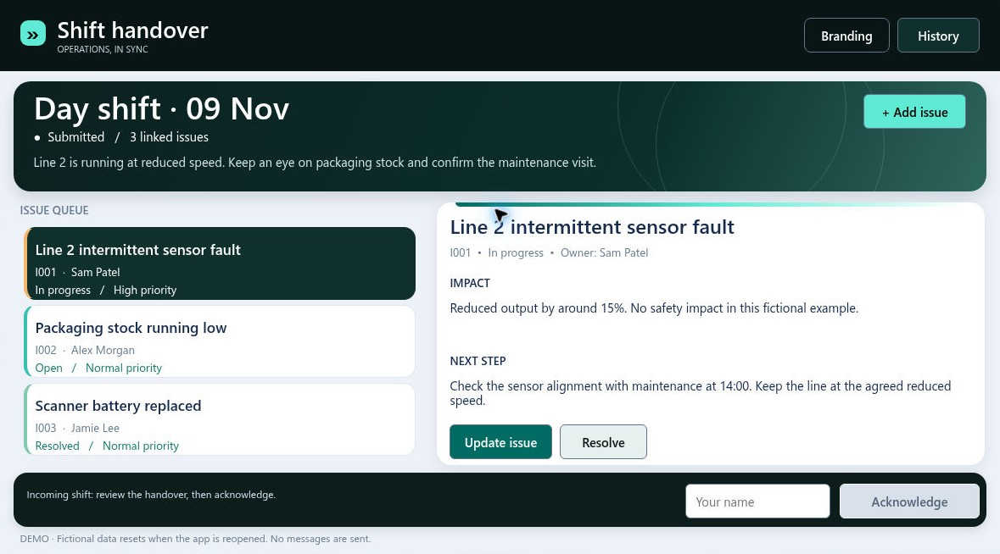
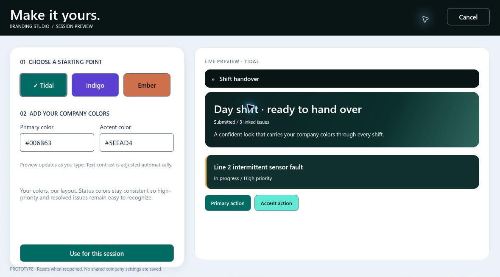
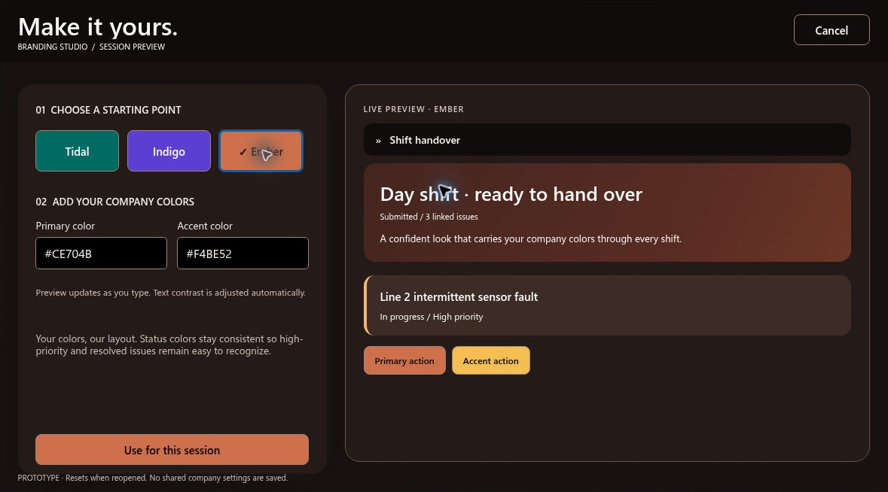

# Shift Handover

## Summary

A canvas app demonstration for handing operational issues from one shift to the next. It shows issue ownership, impact, next steps, acknowledgement, history, and stable-ID carry-forward, with a branding studio for company colors.

**This is a session-only prototype, not a production handover system.** All sample people and incidents are fictional. Data and branding choices reset when the app restarts. No messages are sent. There are no SharePoint, Dataverse or Teams connections.

## Applies to

- Power Apps canvas apps
- Power Fx
- No premium connector, custom connector or external data source required by this sample. Users still need appropriate Power Apps access in their tenant.

## Features

- View open, in-progress and resolved issues with owners and next steps.
- Add and update issues; resolve existing issues.
- Acknowledge a handover and carry unresolved issues into the next handover without duplicating issue identities.
- Session history and fictional seed data.
- Tidal, Indigo and Ember presets, custom primary/accent colors, and automatic foreground contrast selection.

## Prerequisites

A Power Apps environment with permission to create canvas apps and access to Power Apps Studio. No connection setup is needed.

## Installation

1. Download `shift-handover.msapp`.
2. Open Power Apps Studio and use **Open > Browse** (or the local app upload option in your Studio version) to open the `.msapp` file.
3. Save a new copy in your own environment. Run **App > Run OnStart** if seed data is not already visible, then preview the app.
4. Only publish and share your own copy after reviewing the sample's limitations.

This is a standalone canvas app export, not a Dataverse solution ZIP. Do not use the solution import command for this file. The `source/` folder contains the exported `.pa.yaml` files for review; the `.msapp` is the supported opening artifact.

## Try it

Select an issue, inspect its impact and next step, and open **Update issue**. Try **Add issue**, then **Resolve**. Enter a fictional incoming-shift name to enable **Acknowledge**. Use **History** to inspect the session's handovers. Open **Branding**, choose a preset or enter six-digit hex colors, and choose **Use for this session**. **Cancel** restores the previous branding.

## Data model

`colHandovers` stores handovers, `colIssues` stores stable issue records, and `colLinks` associates issue IDs with handover IDs. These are in-memory collections initialized by `App.OnStart`. A production adaptation needs persistent storage, authentication/authorization, concurrent-edit handling, an audit trail and appropriate retention controls. A typed acknowledgement is not an authenticated approval.

## Validation and limitations

The exported app was inspected for external connections and private data. The main preview, branding navigation, Ember preview and branding cancellation were checked in Studio. Full interaction regression, fresh-environment import and screen-reader testing have not been completed. Exported App Checker output contains accessibility/performance recommendations (screen name, decorative surface labels/tab stops, cross-screen event reference and text-input delay). Export metadata reports one parser error despite no binding errors; investigate in a fresh import before production use. This sample is submitted as a draft pending that verification.

## Author

Gavin Warner ([GavinWarner05](https://github.com/GavinWarner05))

## Version history

| Version | Date | Comments |
| --- | --- | --- |
| 1.0 | November 13, 2026 | Initial community demo export |

## Disclaimer

Provided as-is for learning and adaptation, without warranty. Not suitable for safety-critical operations or real operational handovers without further engineering and validation.

